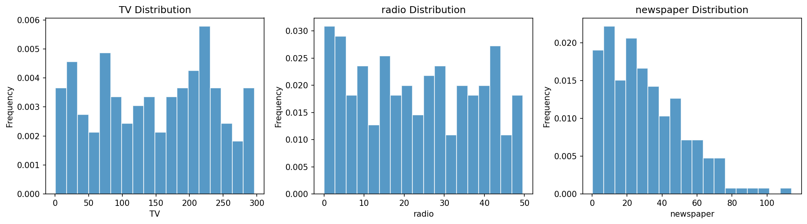
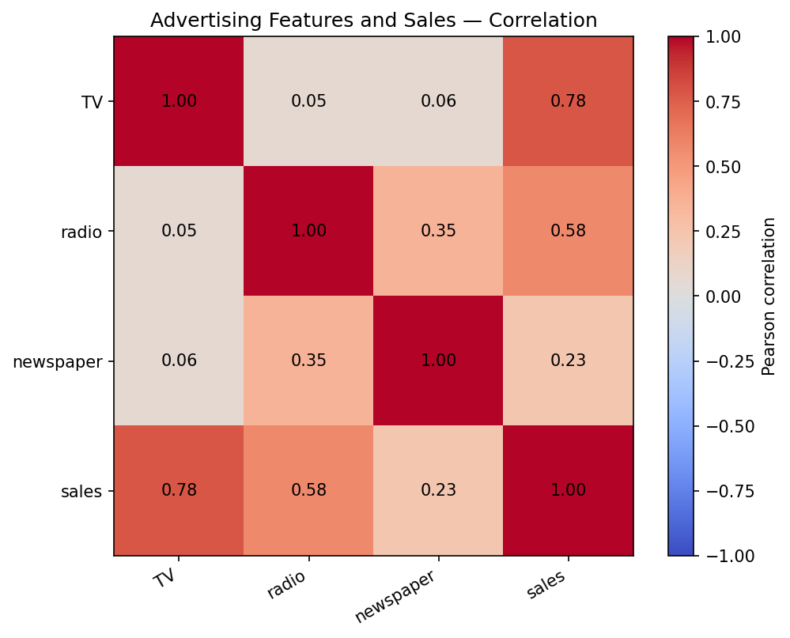
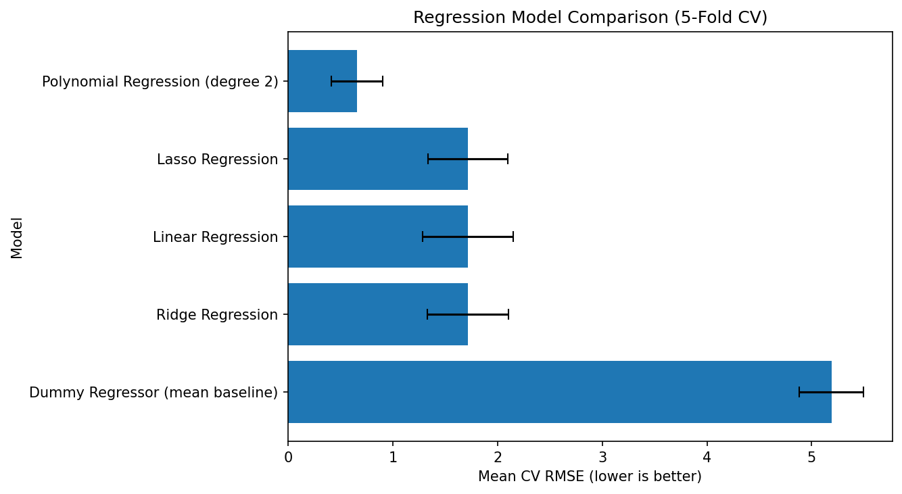
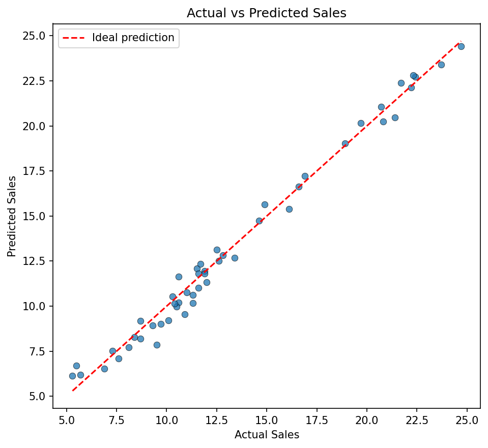
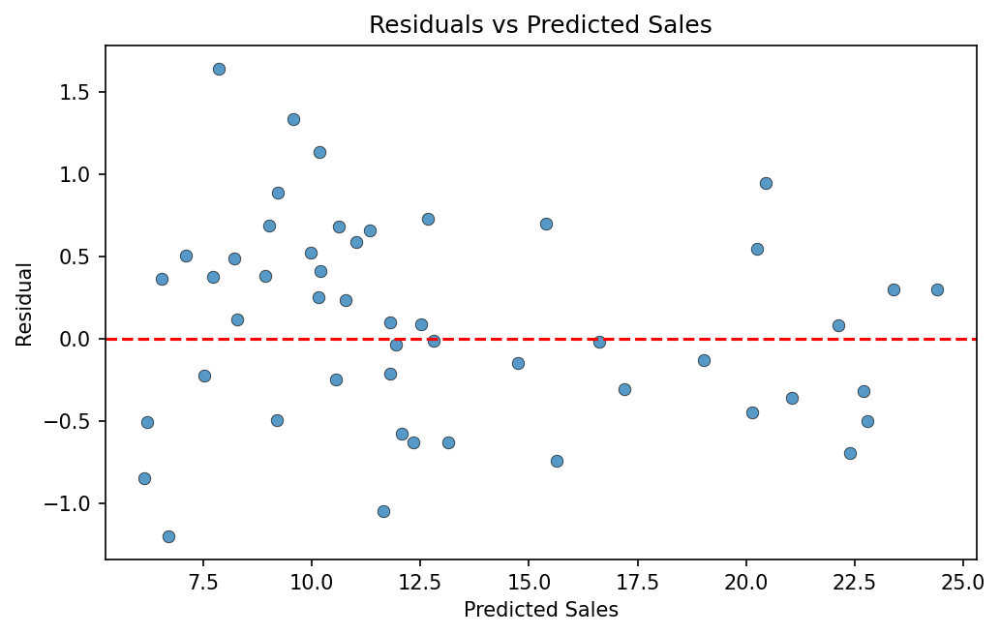

# Advertising Sales Prediction Using Regression and Regularization

A modular machine-learning case study that predicts observed sales from TV, radio, and newspaper advertising inputs. It demonstrates data preparation, regression pipelines, cross-validated model selection, holdout evaluation, model persistence, inference, and an interactive Streamlit dashboard.

> **Important:** This is a predictive exercise using observational data. Model relationships and predictions are not causal estimates of advertising effectiveness, incremental revenue, or return on investment.

---

## 1. Project Overview

The objective is to estimate the `sales` target using three advertising-channel features: `TV`, `radio`, and `newspaper`.

The project is organized in an industrial, modular Python structure. Each responsibility is separated into a dedicated module: configuration, data loading, model training, evaluation, visualization, inference, and dashboard presentation.

### Key practices followed

- Centralized project paths, schema, split settings, and model-search configuration.
- Dataset schema and numeric-value validation before modelling.
- Reproducible 75:25 train/holdout split using random state `42`.
- Scikit-learn pipelines to keep feature expansion and scaling inside cross-validation.
- Comparable model-family evaluation using shuffled 5-fold cross-validation on training data.
- Hyperparameter search for Ridge, Lasso, and Polynomial + Ridge candidates.
- Final evaluation on an untouched holdout partition.
- Model artifact metadata, feature-order checks, and SHA-256 integrity verification.
- Single-row and batch inference with input validation.
- Automated tests for core data, model, artifact, and inference behaviour.

## 2. Problem Statement

Given a row containing the TV, radio, and newspaper advertising inputs, predict the corresponding observed sales value.

The study compares a simple mean baseline, ordinary linear regression, regularized linear models, and degree-2 polynomial regression. The goal is to assess predictive performance on this dataset, not to infer causal impact or recommend advertising-budget allocation.

## 3. Dataset Information

**Dataset file expected locally:** `data/Advertising.csv`

The dataset is available from the official *An Introduction to Statistical Learning* data page. Download [Advertising.csv](https://trevorhastie.github.io/ISLR/Advertising.csv) and place it at `data/Advertising.csv` before running the project. The CSV is intentionally not committed to this repository because the available source page does not state an explicit redistribution license for the standalone file. See [`data/README.md`](data/README.md) for the dataset source and setup instructions.

| Property | Details |
|---|---|
| Total observations | 200 |
| Original columns | 5 |
| Modelling columns after cleaning | 4 |
| Input features | `TV`, `radio`, `newspaper` |
| Target variable | `sales` |
| Missing values after cleaning | 0 |
| Duplicate rows after cleaning | 0 |

The source CSV includes an exported index column named `Unnamed: 0`. The cleaning stage removes this redundant column. All four modelling columns are numeric.

### Feature description

| Feature | Role | Description |
|---|---|---|
| `TV` | Input | TV advertising budget/value recorded in the dataset |
| `radio` | Input | Radio advertising budget/value recorded in the dataset |
| `newspaper` | Input | Newspaper advertising budget/value recorded in the dataset |
| `sales` | Target | Observed sales value to be predicted |

The dataset does not specify the sales unit or currency in the project files. No unit or currency is assumed.

## 4. Project Architecture

```text
Advertising Sales Prediction
│
├── config.py             Central paths, columns, split and model settings
├── data_loader.py        Read, clean, validate, split and summarize data
├── model_training.py     Build pipelines, run CV/search, fit and save model
├── evaluation.py         Metrics, holdout evaluation and report generation
├── visualization.py      EDA, comparison and diagnostic plots
├── main.py               Orchestrates the end-to-end training workflow
├── inference.py          Load verified artifacts and predict single/batch rows
├── app.py                Six-page Streamlit dashboard
├── test_project.py       Automated unit tests
│
├── data/
│   └── README.md           Dataset source and local setup instructions
├── models/                Saved model and metadata (generated)
├── outputs/
│   ├── figures/           Generated visualizations
│   └── reports/           Generated CSV and JSON reports
├── docs/
│   └── images/            Selected figures embedded in this README
├── requirements.txt
├── .gitignore
├── LICENSE
└── README.md
```

### Module responsibilities and execution flow

1. `config.py` defines the dataset schema, project directories, random state, holdout ratio, cross-validation settings, model families, and search grids.
2. `data_loader.py` reads the CSV, removes the redundant index, validates columns and values, creates the split, and summarizes the dataset.
3. `model_training.py` builds scikit-learn pipelines, compares model families with training-only cross-validation, selects the best configuration, refits it on training data, and saves the fitted pipeline with metadata.
4. `evaluation.py` calculates regression metrics, evaluates the selected model on holdout data, extracts coefficient information where applicable, and writes reports.
5. `visualization.py` creates EDA, model-comparison, and regression-diagnostic figures.
6. `main.py` coordinates the full workflow and writes the run summary.
7. `inference.py` verifies and loads saved artifacts, validates input features, and produces predictions.
8. `app.py` provides the interactive Streamlit interface. It loads saved artifacts and does not retrain the model at application startup.


## 5. Data Preparation and Visualizations

The data preparation process removes the exported index, validates the expected schema, checks for missing/non-finite values and duplicate observations, and separates the three predictors from the `sales` target.

### Feature distributions



### Correlation between variables



The correlation plot is descriptive. Correlation alone does not establish causation or prove that changing a channel's advertising input will change sales.

## 6. Model Training and Evaluation Workflow

The workflow is executed in the following order:

1. Load and validate `Advertising.csv`.
2. Generate descriptive summaries and EDA figures.
3. Split the data into 150 training rows (75%) and 50 holdout rows (25%), using `random_state=42`.
4. Run shuffled 5-fold cross-validation on the training partition.
5. Evaluate the configured model families. Ridge, Lasso, and Polynomial + Ridge use compact hyperparameter grids; Dummy and ordinary Linear Regression are evaluated without a search grid.
6. Select the configuration with the lowest mean cross-validation RMSE.
7. Refit the selected pipeline using all 150 training rows.
8. Evaluate the selected model on the 50-row holdout partition.
9. Save the fitted pipeline, metadata, metrics, comparison reports, and figures.

### Pipeline construction

For the polynomial model, the pipeline is:

```text
Original input features
        │
        ▼
PolynomialFeatures(degree=2, include_bias=False)
        │
        ▼
StandardScaler
        │
        ▼
Ridge(alpha=selected value)
        │
        ▼
Predicted sales
```

The polynomial expansion and scaling are inside the scikit-learn pipeline. Therefore, they are fitted separately within each cross-validation training fold and do not learn from that fold's validation rows.

### Models compared

| Model | Purpose |
|---|---|
| Dummy Regressor (mean) | Baseline reference |
| Linear Regression | Ordinary linear model |
| Ridge Regression | L2-regularized linear model |
| Lasso Regression | L1-regularized linear model |
| Polynomial Regression (degree 2) | Degree-2 expansion followed by Ridge |

### Cross-validation model comparison

| Model | Mean CV RMSE | CV RMSE standard deviation | Selected parameter |
|---|---:|---:|---|
| Dummy Regressor (mean) | 5.1898 | 0.3061 | — |
| Linear Regression | 1.7159 | 0.4302 | — |
| Ridge Regression | 1.7159 | 0.3847 | `alpha=0.01` |
| Lasso Regression | 1.7152 | 0.3820 | `alpha=0.01` |
| Polynomial Regression (degree 2) | **0.6567** | 0.2451 | `alpha=0.1` |



### Final holdout evaluation

| Metric | Result |
|---|---:|
| MAE | 0.5079 |
| MSE | 0.3818 |
| RMSE | **0.6179** |
| R² | **0.9859** |

Selected configuration: **Polynomial Regression (degree 2) with Ridge regularization (`alpha=0.1`)**.

Cross-validation scores are used for model selection and may be optimistic because the best configuration is selected from multiple candidates. The holdout partition is kept separate from that selection process and is used for the final performance estimate.

### Regression diagnostics





The diagnostic figures help inspect prediction fit and residual patterns. They do not replace validation on additional independent datasets.

## 7. Dependencies

The project uses the following Python packages:

| Package | Purpose |
|---|---|
| NumPy | Numerical operations |
| Pandas | Data loading and manipulation |
| Scikit-learn | Regression, preprocessing, pipelines, model selection and metrics |
| Matplotlib | Data visualization |
| Joblib | Model persistence |
| Streamlit | Interactive dashboard |

Install the dependencies with:

```bash
python -m pip install --upgrade pip
python -m pip install -r requirements.txt
```

The dependency ranges are bounded to avoid unconstrained major-version upgrades. The project should be validated in a clean environment using the exact `requirements.txt` before publication. Python 3.11+ is the documented baseline; compatibility with every future Python/package release is not implied.

## 8. Running the Project

Run commands from the repository root.

### Step 1 — Create a virtual environment

**Windows PowerShell**

```powershell
python -m venv .venv
.venv\Scripts\Activate.ps1
```

**macOS / Linux**

```bash
python3 -m venv .venv
source .venv/bin/activate
```

### Step 2 — Install packages

```bash
python -m pip install --upgrade pip
python -m pip install -r requirements.txt
```

### Step 3 — Prepare and train the model

Download the dataset as described in [`data/README.md`](data/README.md), save it as `data/Advertising.csv`, then run:

```bash
python main.py
```

This command performs validation, EDA, splitting, cross-validation/model selection, final holdout evaluation, artifact saving, and report generation.

### Expected execution output

Exact elapsed time and some formatting may vary by machine. The successful run should report a selected model and holdout metrics similar to:

```text
Selected model: Polynomial Regression (degree 2)
Selected parameters: {'model__alpha': 0.1}

Holdout evaluation:
MAE  : 0.5079
MSE  : 0.3818
RMSE : 0.6179
R2   : 0.9859

Model artifact saved:
models/advertising_pipeline.joblib
Metadata saved:
models/model_metadata.json
```

The values above are the recorded project-run results, not a guarantee that every library version or environment will reproduce identical floating-point values.

### Step 4 — Launch the dashboard

After the training command succeeds:

```bash
streamlit run app.py
```

The dashboard reads the saved model and metadata. It does not automatically retrain the model.

### Step 5 — Run automated tests

```bash
python -m unittest -v test_project.py
```

Run `python main.py` once before running the tests in a fresh clone because the artifact-related tests expect a saved model.

## 9. Model Storage, Loading and Prediction

### Model storage

The training workflow generates the following files:

```text
models/
├── advertising_pipeline.joblib
└── model_metadata.json
```

- `advertising_pipeline.joblib` contains the fitted scikit-learn pipeline.
- `model_metadata.json` records model details, expected feature order, training information, and the SHA-256 checksum used by the inference loader.

Generated model files and reports are excluded from Git by `.gitignore`; the directories are retained with `.gitkeep`. Run the training workflow to recreate the artifacts.

### Loading the saved model

The supported loading path verifies the model artifact against its metadata before returning the fitted pipeline:

```python
from inference import load_model_artifacts

pipeline, metadata = load_model_artifacts()
print(metadata["model_name"])
```

Only load Joblib/pickle-based artifacts from trusted sources. Loading an untrusted serialized model can execute arbitrary code.

### Sample prediction

The model expects the original three input features in the configured order. Do not manually apply polynomial expansion or scaling; those transformations are already part of the saved pipeline.

```python
from inference import predict_single

sample = {
    "TV": 150,
    "radio": 25,
    "newspaper": 20
}

prediction = predict_single(sample)
print(prediction)
```

Recorded sample prediction:

```text
Predicted sales: approximately 15.0873
```

The prediction is expressed in the dataset's target units, which are not specified in the source files.

### Batch prediction input

A batch CSV must contain exactly the expected feature columns:

```csv
TV,radio,newspaper
150,25,20
230.1,37.8,69.2
```

The inference layer checks column names and values, rejects invalid or empty input, and warns when values are outside the ranges observed in the training dataset.

## 10. Streamlit Dashboard

The dashboard contains six pages:

| Page | Main functionality |
|---|---|
| Overview | Dataset preview, summary and holdout metrics |
| EDA | Feature/target distributions, relationships and correlation |
| Model Comparison | CV results, selected parameters and holdout results |
| Diagnostics | Actual-versus-predicted, residual plots and coefficient analysis |
| Sales Prediction | Interactive prediction for one scenario |
| Batch Prediction | CSV upload, batch predictions and downloadable results |

The dashboard is intended for local exploration. Test all pages in the target deployment environment before hosting it publicly.

## 11. Expected Generated Files

After a successful `python main.py` execution:

```text
models/
├── advertising_pipeline.joblib
└── model_metadata.json

outputs/
├── figures/
│   ├── actual_vs_predicted.png
│   ├── correlation_heatmap.png
│   ├── feature_distributions.png
│   ├── feature_target_relationships.png
│   ├── model_coefficients.png
│   ├── model_comparison_cv.png
│   ├── residual_distribution.png
│   ├── residuals_vs_predicted.png
│   └── target_distribution.png
└── reports/
    ├── coefficient_analysis.csv
    ├── cv_model_comparison.csv
    ├── dataset_summary.json
    ├── holdout_metrics.json
    ├── model_comparison_with_holdout.csv
    └── run_summary.json
```

## 12. Limitations

- The dataset contains 200 observations; results may vary on a different sample.
- The project uses one reproducible holdout split rather than multiple independent datasets.
- Selecting the best candidate from several CV results can make the winning CV score optimistic.
- Polynomial features increase model flexibility and may overfit small datasets.
- The dataset is observational; coefficients and correlations do not establish causality.
- Sales units and currency are not identified in the project files.
- The official ISLR data page provides the Advertising CSV download, but the page does not state an explicit redistribution license for the standalone CSV. The dataset is therefore excluded from this repository; obtain it from the official source and place it in `data/` locally.

## 13. Author

**Vivaan Kukreja**  
B.Tech — Information Technology  
AISSMS Institute of Information Technology

- GitHub: [Vivk1560](https://github.com/Vivk1560/)

## 14. License and Dataset Notice

The project source code is licensed under the MIT License. See [LICENSE](LICENSE).

The dataset is third-party content and is not included in this repository. The official [ISLR data page](https://trevorhastie.github.io/ISLR/data.html) provides the [Advertising.csv download](https://trevorhastie.github.io/ISLR/Advertising.csv), but does not state an explicit redistribution license for that standalone file. The MIT License in this repository applies only to the project source code and does not grant rights to the dataset. Refer to [`data/README.md`](data/README.md) for details.
